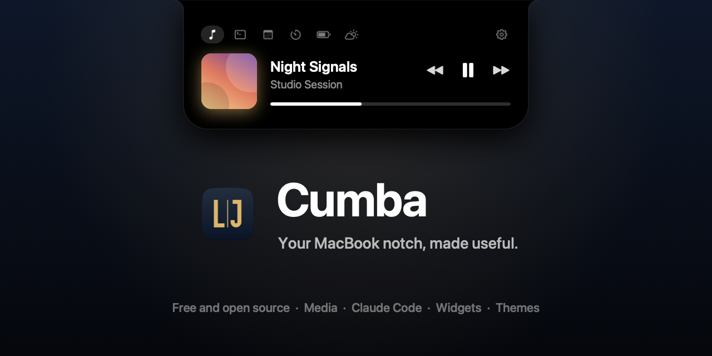

<p align="center"></p>

<h1 align="center">Cumba</h1>

<p align="center"><sub>by LJASP · formerly ljaspNotch</sub></p>

<p align="center">
  <a href="https://github.com/muazfurkan/Cumba/releases/latest"></a>
  <a href="https://github.com/muazfurkan/Cumba/actions/workflows/build.yml"></a>
  
  <a href="LICENSE"></a>
</p>

<p align="center"><a href="README.tr.md">Türkçe</a></p>

A free, open source notch app for macOS. It turns the MacBook notch into a panel that grows out of the camera housing when you rest the pointer on it: whatever is playing, what your AI coding agents (Claude Code and Codex) are doing, and a set of widgets, all in a look you can make your own.

A *cumba* is the small bay window that juts out from the upper floor of old Turkish houses: a quiet place to sit and see what's happening in the street. The panel does the same from the top of your screen.

> **Project status:** Cumba is new (first release October 2026) and made by one maintainer with AI assistance (Claude Code). It hasn't had an external security audit. The code is small and open, releases are built by GitHub Actions from tagged commits, and [what it can access](#permissions-and-what-runs) and [how to check a download](#download-and-install) are listed below.

## Features

- **Media**: whatever any app plays (Safari, Chrome, YouTube, Spotify, Music, podcasts and more) in one mini player with artwork, progress, seeking and controls, with no extension or setup. A small waveform beside the notch shows what's playing.
- **AI agents (Claude Code and Codex)**: what the agent is doing right now, its last answer and how full its context window is, with a ring beside the notch while it works. When it asks a question, needs permission or finishes, a notification opens under the notch with what happened and **Open**, which brings the agent's app forward. Opening the panel while an agent works shows its tab. Permission requests show up with **Allow**, **Deny** and **In Terminal**; questions and plans stay in the agent, and the notch tells you it's waiting.
- **Widgets in tabs**: calendar with a Join button for video calls (scroll through the days to see any day's events), timer, Pomodoro, your Apple Notes (recent notes, and new ones from the panel), to-dos from Apple Reminders (tick them off, add new ones), clipboard history (text, links, images, files and new screenshots as cards), keep awake, teleprompter, battery, file tray with AirDrop, camera mirror, weather, Shortcuts and a CPU/memory graph. Add them from a gallery in the panel or in Settings, switch tabs with a two-finger swipe; a new installation starts with just three.
- **A panel that fits**: tabs at the bottom or the top, edited right in the panel (name, symbol, order, widgets). The panel is as wide as the open tab, and a widget alone in its tab shows a detailed view: weather with the next hours and days like Apple's widget, the whole month beside your events, large album art. Text size is adjustable, and so is how far the closed notch reaches past the camera.
- **Optional extras**, off until you turn them on: show the panel on any display, the notch in place of the system volume and brightness indicators, a dot while the microphone or camera is in use, a countdown before meetings, a choice of media sources, and an [API for your own scripts](#scripts).
- **Live activities**: a running timer, a working AI agent, a pending request, charging, the current song or a volume or brightness change appear on both sides of the closed notch.
- **Themes**: seven built in, from plain black and Liquid Glass to Neon Tokyo, Sakura and Synthwave. Make your own: glass, solid or tinted, a gradient background, a neon edge, colors, font, corner radius, shadow and animation. Panel size and text size stay the same whichever theme you pick. Import and export themes as JSON.
- **Stays out of the way**: clicks pass through to the menu bar, dragging windows past the notch doesn't open it, it works in full screen apps too (or hides there, if you like), and idle CPU use is zero. Right-click the notch for Settings.
- English and Turkish interface.

## Download and install

1. Get `Cumba-vX.Y.Z.dmg` (or the `.zip`) from the [latest release](https://github.com/muazfurkan/Cumba/releases/latest).
2. **Check the download before opening it.** Its SHA-256 must match the one in `SHA256SUMS.txt` on the release page:
   ```bash
   shasum -a 256 ~/Downloads/Cumba-vX.Y.Z.dmg
   ```
   From 1.1.0 on, releases are also immutable (files and tag can't change after publishing) and carry signed build provenance. With the [GitHub CLI](https://cli.github.com) you can confirm the file was built from this repository by its release workflow:
   ```bash
   gh attestation verify ~/Downloads/Cumba-vX.Y.Z.dmg --repo muazfurkan/Cumba
   ```
3. Open the disk image and drag Cumba to Applications.
4. Cumba isn't notarized by Apple, because that needs a paid developer account, so macOS blocks the first launch. Open it once, then click **Open Anyway** in **System Settings > Privacy & Security**. If you'd rather not run a downloaded build at all, [build it from source](#build-from-source).
5. A short welcome lets you try the panel. Cumba lives in the menu bar; if its icon hides behind the notch, right-click the notch for Settings.

<details>
<summary>Terminal alternative to Open Anyway</summary>

`xattr -dr com.apple.quarantine /Applications/Cumba.app` removes the download flag from this one app, so Gatekeeper stops asking. Only do this for a copy you checked in step 2.
</details>

**Updates:** the app tells you when a new version is out; it never downloads or installs anything itself. Release builds are signed ad hoc, so after an update macOS asks again for the permissions you gave (Automation, Calendar, Location, Camera) and for Keychain access to Cumba's tokens. Check the new download first, then allow.

**Coming from ljaspNotch?** Cumba is the same app under a new name. Quit ljaspNotch, move `ljaspNotch.app` to the Trash and install Cumba; your settings, layout, notes and themes carry over. If you use Claude Code hooks, click **Update…** once in Settings > Agents. If you use the Chrome extension, remove it in `chrome://extensions`, load it again from the new app as in [YouTube and YouTube Music](#youtube-and-youtube-music) and paste the token.

## Requirements

- A Mac with a notch (other Macs can show a virtual notch, see Settings > General)
- macOS 26 or later

## Build from source

You need Xcode 26 or later and [Homebrew](https://brew.sh).

```bash
brew install xcodegen
git clone https://github.com/muazfurkan/Cumba.git
cd Cumba
cp Local.xcconfig.example Local.xcconfig   # then set your DEVELOPMENT_TEAM
xcodegen generate
open Cumba.xcodeproj
```

See [CONTRIBUTING.md](CONTRIBUTING.md) for details.

## Permissions and what runs

Everything below is off or unused until you turn on the feature that needs it. Settings > Permissions shows the current state of each.

| What | Why | When |
|---|---|---|
| System Now Playing helper | Media from every app, and its controls | Runs while the app runs; turn off "Read media from every app" to use AppleScript instead. See [below](#media-and-private-apis) |
| Automation (Apple Events) for Spotify and Music | Read the current track; play, pause, skip, seek | Only with "Read media from every app" off; asked from Settings, scripts are sent only while that app is already running |
| Automation (Apple Events) for Notes | Notes widget: list your recent notes, open one, make new ones | Asked when you connect Notes in the widget or in Settings; Cumba starts Notes in the background and never changes an existing note |
| Calendar (full access) | Calendar widget | Asked when you click Allow in the widget or in Settings |
| Reminders (full access) | To-dos widget: show, tick off and add reminders | Asked when you click Allow in the widget or in Settings |
| Location | Weather widget, for the weather where you are | Asked when you click Use My Location; off if you choose a city instead |
| Camera | Mirror widget | Only while the panel shows it; nothing is recorded |
| Local server on `127.0.0.1` | Optional YouTube extension connection | Only after you turn it on in Settings > Connections |
| Private Unix socket | Claude Code and Codex hooks, and [script activities](#scripts) | Only while hooks are installed or script activities are on |
| `~/.claude/settings.json`, `~/.codex/hooks.json` | Installing and removing the Claude Code and Codex hooks | Only after you review the change; a backup is kept |
| Claude Code transcripts in `~/.claude/projects` | Context use and session title in the AI Agents widget | Read on this Mac only, the last 256 KB, while a session runs |
| Accessibility | Handling the volume or brightness keys | Only if you turn on "Replace the system volume indicator" or "…brightness indicator" |
| Clipboard | Clipboard History widget | Only while that widget is in the panel |
| Files and Folders (Desktop, or wherever screenshots go) | Adding new screenshots to Clipboard History | Only if you turn on "Add new screenshots" |
| Login item | Launch at login | Off until you turn it on |
| Network | Artwork, weather, update check | See [Privacy](#privacy) |

The App Sandbox is off: a sandboxed app would need exceptions to script Spotify and Music, to run the socket Claude Code's hooks reach, and to edit `~/.claude/settings.json`. Hardened Runtime is on, and the app has only the entitlements in [Cumba.entitlements](Cumba/Resources/Cumba.entitlements) (Apple Events, calendars, location, camera).

Cumba never sends telemetry, asks for no administrator password, installs no helper tools, kernel or system extensions, doesn't change system settings, and never downloads code or updates itself. [SECURITY.md](SECURITY.md) has the threat model and a map of the security-relevant code.

<a name="media-and-private-apis"></a>

## Media, brightness and private APIs

macOS has no public way for an app to see what other apps play or to read the built-in display's brightness on Apple silicon. Cumba uses two private Apple frameworks for exactly these, and nothing else:

- **MediaRemote**, the system's Now Playing (what the media keys and Control Center use). macOS answers it only for Apple's own programs, so Cumba runs a small helper library from its own app bundle ([source](NowPlayingHelper/CumbaNowPlaying.m)) inside the system's `/usr/bin/perl`, started with an empty environment. The helper only reads Now Playing and passes on play, pause, skip and seek; it opens no files or network connections and exits when Cumba quits. Turn off **Settings > Widgets > Media > Read media from every app** to use AppleScript for Spotify and Music and the extension for YouTube instead.
- **DisplayServices**, only for the brightness level in the notch. Turn off **Settings > General > Show brightness changes in the notch** to stop using it.

Private APIs can change with any macOS update. If they stop working, Cumba falls back to the public ways above and keeps running.

## YouTube extension (optional)

Not needed while Media reads from every app. A small Chrome extension (also works in other Chromium browsers) sends what plays in YouTube tabs to the app over a local connection, and the app sends play, pause, next and seek back.

1. In Cumba, open **Settings > Connections**, turn on **Connect the YouTube extension** and click **Show Extension Folder**.
2. In Chrome, open `chrome://extensions`, turn on **Developer mode** and click **Load unpacked**. Choose the folder from step 1.
3. Open the extension's **Details > Extension options**, paste the port and the token from **Settings > Connections**, and save.

Chrome will say the extension can read and change your data on `youtube.com` and `music.youtube.com`: it reads the player (title, artwork, progress) and presses play, pause, next and seek there. It runs on no other site, its only other permission is storage (for the port and token), and it talks only to `127.0.0.1`.

## Claude Code and Codex

The AI Agents widget shows what a session is doing right now ("Editing Notch.swift", "Running tests"), its title and last answer, and how full its context window is. Permission requests from Claude Code (terminal, IDE extensions and the Claude desktop app) appear in the notch with **Allow**, **Deny** and **In Terminal**, and you see when a session finishes or fails. The card shows the full request with hidden characters made visible. Questions and plan approvals aren't permission requests: Claude Code asks them itself, and the notch shows the session is waiting. Install the hooks in **Settings > Agents**; you review the change to `~/.claude/settings.json` first and a backup is made. Hooks reach the app through a private socket that only your user account can open, so nothing else can answer Claude Code in its place; they use their own token, separate from the extension's.

**Codex** works the same way: install its hooks in **Settings > Agents > Codex** (they go to `~/.codex/hooks.json`), then run `/hooks` in Codex once and trust them, since Codex runs new hooks only after that.

**Allow in the notch is the same as Allow in Claude Code: the tool runs right away.** In Settings > Agents you can allow everything except shell commands from the notch, or turn Allow off and keep only Deny and In Terminal. Requests with hidden characters never get an Allow button. See [docs/claude-code-setup.md](docs/claude-code-setup.md) for details and manual setup.

## Scripts

Turn on **Settings > Connections > Scripts** to let your own scripts, Shortcuts or build tools show a short status beside the notch. **Copy Example Command** copies a ready-to-run command with your token:

```bash
curl -s --unix-socket "$HOME/Library/Application Support/Cumba/hook.sock" \
  -H "X-Cumba-Token: <token>" -H "Content-Type: application/json" \
  -d '{"id":"build","title":"Build done","symbol":"hammer","duration":5}' \
  http://localhost/activity
```

Fields: `id` (letters, digits, `.`, `_` and `-`), `title` (up to 60 characters), `symbol` (an SF Symbol name), `progress` (0 to 1, shows a bar), `duration` (seconds, 1 to 3600), and `"remove": true` to take an activity away. Activities are text only, escaped like Claude Code requests, and nothing in them can be clicked.

## Privacy

No telemetry. Everything stays on your Mac. These features make network requests, and only while you use them:

| Feature | Request |
|---|---|
| Media widget with Spotify | Album artwork from Spotify's image server (`i.scdn.co`), for the panel and the closed notch |
| Media widget with YouTube | Thumbnails from YouTube's image servers (`*.ytimg.com`, `*.googleusercontent.com`, `*.ggpht.com`; the URL the page itself uses), for the panel and the closed notch |
| Weather widget | Your location rounded to about 10 km (or the coordinates of the city you choose) to `api.open-meteo.com`; with your location, the same rounded coordinates to Apple Maps for the city name; a city you search for, with your language, to `geocoding-api.open-meteo.com`. Only while the widget is on screen, at most every 15 minutes |
| Update check | The list of releases from `api.github.com` at launch and once a day, with Cumba's version as the user agent; turn it off in Settings > General |

The camera (Mirror widget) runs only while the panel shows it, and nothing is recorded. The Tray keeps only file paths on your Mac. Notes and To-dos read and write Apple Notes and Apple Reminders on your Mac; nothing is copied or sent anywhere. The note of earlier versions (`notes.txt`) is moved to Apple Notes once, and the file is left in place. Clipboard History keeps your last 20 copies (text, links, images and files) in memory only and skips items apps mark as passwords; while it's in one of your tabs it checks once a second whether the clipboard changed, even with the panel closed, so it doesn't miss a copy. With "Add new screenshots" on, it watches the screenshot folder for new screenshots and keeps only their location. The microphone and camera indicator reads only whether a device is in use, never audio or video.

When turned on, the extension server listens only on `127.0.0.1`, accepts only the Cumba extension and requires its own token, stored in your Keychain.

## Uninstall

1. If you installed the Claude Code or Codex hooks, remove them first in **Settings > Agents > Remove…** (for each agent). Hooks left behind do nothing once the app is gone, but they stay in `~/.claude/settings.json` and `~/.codex/hooks.json`.
2. Turn off **Launch at login** in Settings > General, quit Cumba from the menu bar and move it to the Trash.
3. Remove the extension in `chrome://extensions`.
4. To delete its data too (themes, layout, notes, preferences and the tokens):
   ```bash
   rm -rf ~/Library/Application\ Support/Cumba
   defaults delete io.github.muazfurkan.ljaspnotch
   security delete-generic-password -s io.github.muazfurkan.ljaspnotch.server -a token
   security delete-generic-password -s io.github.muazfurkan.ljaspnotch.server -a extension-token
   security delete-generic-password -s io.github.muazfurkan.ljaspnotch.server -a scripts-token
   ```
   Backups made during hook setup are next to the files they back up, as `~/.claude/settings.json.bak-…` and `~/.codex/hooks.json.bak-…`; keep or delete them.

## Contributing

Questions and ideas are welcome in [Discussions](https://github.com/muazfurkan/Cumba/discussions). Contributions are welcome too; please read [CONTRIBUTING.md](CONTRIBUTING.md) and the [Code of Conduct](CODE_OF_CONDUCT.md). Report security issues privately as described in [SECURITY.md](SECURITY.md).

## License

[MIT](LICENSE)
